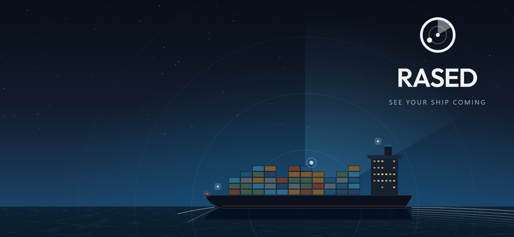
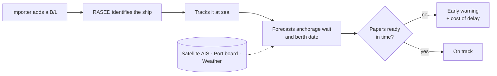
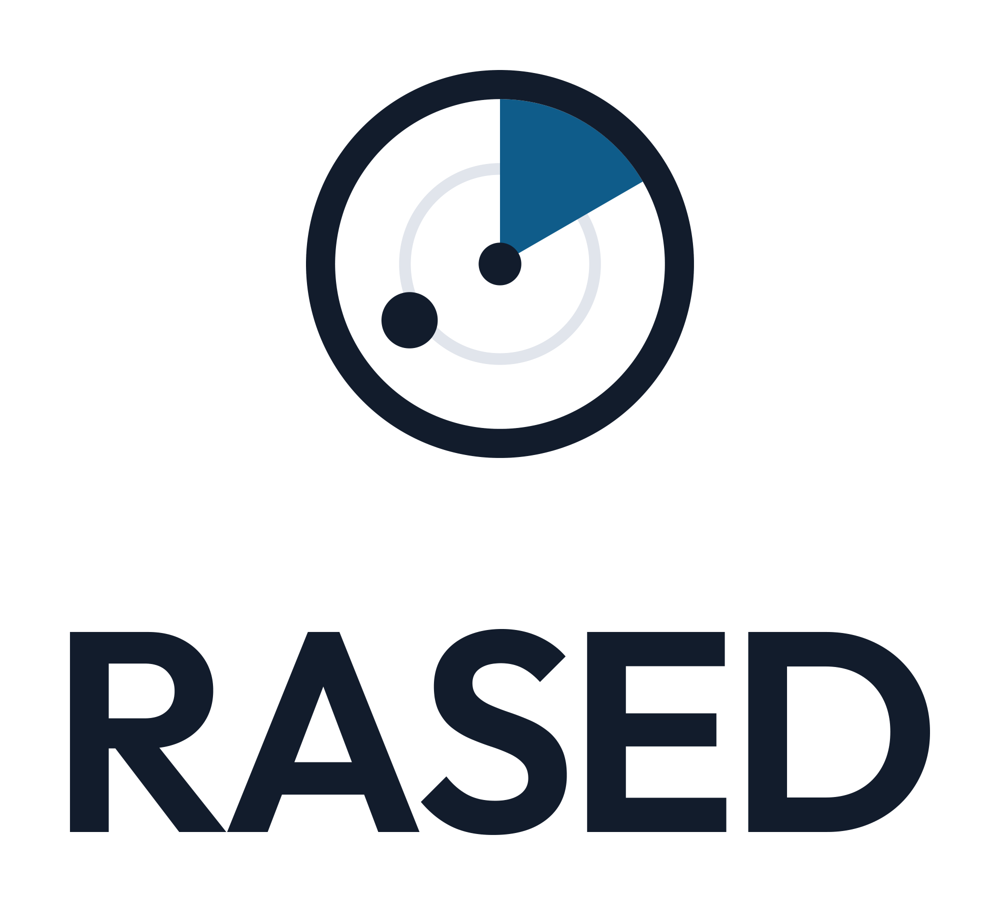

  

<h1 align="center">RASED · راصد</h1>

  <b>Know when your ship will <i>really</i> berth at Alexandria, and whether your papers will be ready in time.</b> 
  Smart Port &amp; Maritime Congestion Predictor

  
  
  
  

---

## What RASED does

Egyptian importers and freight forwarders only have the arrival date written on the bill of lading, and that date is a promise, not a fact. Ships often wait at anchorage outside Alexandria for days, and the importer finds out only when storage and container fees have started.

**RASED closes that gap:**

1. The importer adds a shipment: a photo of the bill of lading (B/L), its number, an Excel list or a ship name.
2. RASED identifies the ship and follows it at sea.
3. Machine learning on satellite ship-tracking (AIS) history, the Alexandria Port Authority ship board and weather data **forecasts the anchorage wait and a realistic berth date**, as a range with the reasons behind it.
4. RASED compares that date with the importer's paperwork and **warns two to three days ahead** when papers will be late, with the **cost of the delay in Egyptian pounds**.

Behind it runs a production **data engineering + MLOps** pipeline: streaming ingestion, a feature store, a model registry, drift monitoring, and automatic retraining and rollback. Every forecast is checked against the real berth time.

New to shipping terms (AIS, anchorage, demurrage, B/L)? Start with **[Maritime 101](docs/maritime-101.md)**.

## 📄 Documents

| | |
|---|---|
| 📘 **[Proposal v3](docs/proposal/proposal.pdf)** | Problem, solution, competitors, feature matrix and 195 requirements (30 pages) |
| 🧭 **[Positioning](docs/positioning.md)** | Current direction, competitors and what makes RASED different |
| 🗂️ **[All documents](docs/README.md)** | Everything in `docs/`, with a suggested reading order |
| 🎓 **[Senior Project 1 plan](docs/course/senior-project-1-requirements.md)** | The department template, chapter by chapter, with status |
| 🧾 **[Decision log](docs/decision-log.md)** | Every decision we made and why |

## 📅 Status — 25 November 2026

- **Direction:** import/export shipments into Alexandria; the forecast horizon is days, not hours.
- **Proposal v3** submitted on 14 Nov 2026, built from a clickable English/Arabic prototype.
- **Documentation sprints** (team targets): Chapters 1–2 on **29 Nov**, Chapter 3 (design) on **6 Dec**, Chapter 4 + the complete document on **13 Dec 2026**.
- This repository holds **documents only** while the supervisor reviews them. Source code will be added after approval.

## 👥 Team

| | Member | Role |
|---|---|---|
| 🧭 | **Mohamed Mahmoud** | Team Lead — MLOps Engineer & Data Engineer |
| 🛠️ | **Reem Adel** | Data Engineer |
| 🛠️ | **Alhassan Mohamed** | Data Engineer |
| 🛠️ | **Youssef Nasser** | Data Engineer |
| 🛠️ | **Youssef Elkomy** | Data Engineer |

**Supervisor:** Prof. Mohamed Kholief
**Alexandria University — Faculty of Science — Software Industry and Multimedia (SIM) Department**

---

  <picture>
    <source media="(prefers-color-scheme: dark)" srcset="brand/rased_logo_dark.png">
    
  </picture> 
  Satellite AIS data powered by <a href="https://globalfishingwatch.org">Global Fishing Watch</a> (CC BY-NC 4.0, non-commercial use).

