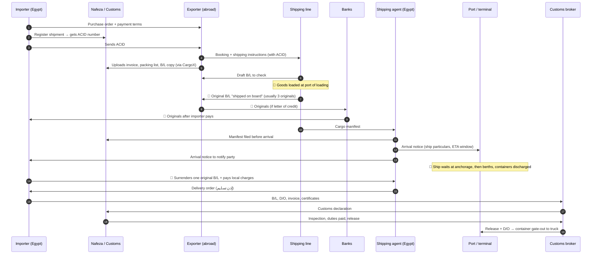
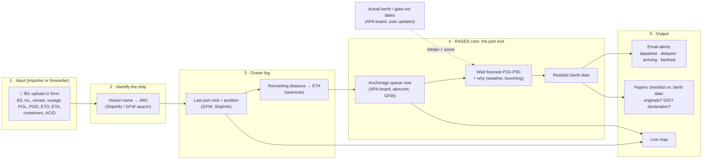

# How an Import Shipment Moves: the Bill of Lading, Step by Step

Research: 2026-11-01. Context: the face-to-face meeting with Captain-2, where the team agreed that RASED focuses on **import/export shipments** (option b in O-008, [decision-log.md](decision-log.md)). B/L fields and data sources: [shipment-data-sources.md](shipment-data-sources.md). Shipping terms: [maritime-101.md](maritime-101.md).

> **Use this as background for the company interviews, not as legal advice.** The general flow is standard worldwide. The Egyptian steps (ACI, Nafeza, delivery order) come from carrier advisories, customs-news summaries and filing-service guides, and Egyptian rules changed in 2021 and again in 2026. Check every Egypt-specific step with an importer and a customs broker (see the questions at the end).

## 1. First, a correction: the port does not issue the bill of lading

The **shipping line (the carrier)**, or its agent at the port of loading, issues the B/L. Not the port authority, and not customs. A freight forwarder can also issue its own B/L to its client (a *house* B/L, see §4).

The port authority only sees the *ship* (arrival, berth, departure). Customs sees the *cargo data* (manifest, declaration). The B/L itself travels between companies: **shipping line → exporter → (bank) → importer → back to the shipping line's agent in Egypt**.

A B/L does three jobs at once:

1. **Receipt:** "we, the carrier, received these goods."
2. **Contract:** proof of the transport deal between the exporter and the shipping line.
3. **Title (ownership paper):** whoever holds the original B/L can collect the goods. That is why the original matters so much.

## 2. Who is who (plain English)

| Who | Arabic (common usage) | What they do |
|---|---|---|
| **Exporter / shipper** | المصدّر / الشاحن | Sells the goods abroad and hands them to the carrier |
| **Importer / consignee** | المستورد / المرسل إليه | Buys the goods in Egypt and collects them |
| **Notify party** | جهة الإخطار | Who the carrier calls when the ship arrives (often the importer or its broker) |
| **Shipping line / carrier** | الخط الملاحي | Owns or runs the ship. **Issues the master B/L** |
| **Shipping agent in Egypt** | التوكيل الملاحي | Represents the shipping line in Egypt: tells the port the ship is coming, files the manifest with customs, collects the original B/L and **issues the delivery order** |
| **Freight forwarder** | وكيل الشحن / الشاحن الدولي | Organizes the transport for a client. May issue a **house B/L** |
| **Customs broker** | المخلّص الجمركي | Files the customs declaration and gets the cargo released |
| **Banks** | البنوك | Under a letter of credit, hold the original B/L until the importer pays |
| **Port authority / terminal** | هيئة الميناء / المحطة | Gives the ship an anchorage and a berth; stores the container until it leaves |
| **Customs (via Nafeza)** | الجمارك / منصة نافذة | Pre-registers the cargo (ACI), checks the declaration, collects duties, releases |
| **Trucker** | النقل البري | Takes the container from the port to the importer |

## 3. The sequence, start to finish

### 3a. The whole journey as one picture

Each lane is one party. The arrows show what passes between them. 📄 = a document, 🚢 = the ship.

### 3b. The same steps as a table: who does it, who sees it, what RASED does

**Legend:** 🟢 RASED reads or uses it · 🔵 RASED's own value is added here · ⚪ outside RASED

| # | Step | Done by | Who sees it | RASED |
|---|---|---|---|---|
| 1 | Purchase contract: what, how much, Incoterm (who pays the freight), payment by letter of credit or transfer | Importer + exporter | Both, their banks | ⚪ |
| 2 | **ACI pre-registration on Nafeza → ACID number** (19 digits). Mandatory for sea imports since 1 Oct 2021; must be done **before loading** | Importer or its broker | Importer, customs, then exporter and carrier | 🟢 ACID stored with the shipment |
| 3 | Exporter registers on **CargoX** and uploads invoice, packing list, certificate of origin and B/L copy to Nafeza | Exporter | Customs | ⚪ (status could be a checklist item, see §6) |
| 4 | **Booking:** exporter (or its forwarder) books space on a ship; sends **shipping instructions** with the ACID | Exporter / forwarder → shipping line | Line, forwarder | ⚪ |
| 5 | **Draft B/L** sent for checking. Errors fixed here cost nothing; after issue they cost amendment fees | Shipping line | Exporter, forwarder | ⚪ |
| 6 | Container packed, sealed, taken to the port of loading, **loaded on the ship** | Exporter, trucker, terminal | Line, terminal | ⚪ |
| 7 | **B/L issued:** "shipped on board", usually a set of 3 originals. **Carries vessel name, voyage, port of loading, port of discharge, containers, ACID** | Shipping line (master B/L); forwarder too if it issues a house B/L | Exporter first | 🟢 **RASED starts here: the B/L is the input** |
| 8 | Originals travel: courier to the importer, or through the banks under a letter of credit. Or no paper at all: telex release / sea waybill (§4) | Exporter, banks | Banks, importer | 🔵 "Are the originals in your hand yet?" checklist |
| 9 | **Ship sails** (ETD). Ocean leg: days to weeks (e.g. ~22 days Shanghai → Alexandria via Suez at 14 knots, our searoute test) | Shipping line | Everyone can see the ship on AIS | 🟢 Track the ship (GFW port visits, ShipInfo position) |
| 10 | **Manifest** (list of all cargo on the ship) filed with Egyptian customs **before arrival**. A 2021 carrier advisory said 48 h before ETA for voyages under 3 days, 72 h for others | Shipping line → agent in Egypt | Customs | ⚪ |
| 11 | **Pre-arrival notice to the port**: agent gives the arrival window and ship particulars 1–2 weeks ahead; ETA confirmed by VHF 24 h before (Captain-1) | Shipping agent | Port authority | 🟢 APA board "expected ships" |
| 12 | **Arrival notice** to the notify party: "your cargo arrives on …" | Shipping agent | Importer, broker | 🔵 RASED's alert comes earlier and with a realistic date |
| 13 | **Ship arrives → waits at anchorage → berths**. Waiting can be hours to days (no free berth, weather, ships bunching up, per Captain-2) | Port authority, pilots, tugs | Port, agent | 🔵 **RASED's core: anchorage-wait forecast → realistic berth time** |
| 14 | Containers discharged to the terminal yard. **Free days start counting** for storage and container use | Terminal | Terminal, agent | 🔵 Free-days countdown |
| 15 | **Importer surrenders one original B/L** to the agent and pays local charges | Importer → agent | Agent | 🟢 Status update |
| 16 | **Delivery order (D/O, إذن تسليم)** issued: permission to take the container | Shipping agent | Importer, broker, terminal | 🟢 Status update |
| 17 | **Customs declaration** on Nafeza; inspection; duties paid. Since Decree 262/2026 the declaration can start **before** the D/O, but the D/O is needed before final release (always for "to order" B/Ls) | Customs broker | Customs | 🟢 Status update |
| 18 | **Release + gate-out**: container leaves on a truck | Broker, terminal, trucker | Terminal | 🟢 Shipment closed; real dates feed the model |
| 19 | Empty container returned to the shipping line | Trucker | Line | 🔵 Detention countdown (late fee for keeping the box) |

**The money is lost between steps 13 and 19.** If the papers (step 8, 15–17) are not ready when the ship berths (step 13), the container sits in the yard and the importer pays storage and demurrage/detention. That gap is RASED's opening: the port knows when the ship berths, but the importer usually does not, and the importer knows where the papers are, but nobody compares the two.

## 4. Types of bill of lading (the ones Captain-2 showed)

The same B/L can be described along several independent lines. One document is, for example, "a master, shipped-on-board, clean, to-order B/L".

### By who issues it

| Type | Issued by | To whom | Why it matters for RASED |
|---|---|---|---|
| **Master B/L (MBL)** | Shipping line | Exporter, or the forwarder | Carries the real vessel and voyage. The line's agent in Egypt only accepts this one for the D/O |
| **House B/L (HBL)** | Freight forwarder (NVOCC: a forwarder that acts as carrier without owning ships) | The forwarder's client | What a small importer usually holds. Our input must accept both; the HBL may show a different B/L number from the one the shipping line tracks. In Egypt each house B/L has its own ACID (Nafeza FAQ via search; verify) |

### By who can collect the goods (title)

| Type | Plain English | Original needed at destination? |
|---|---|---|
| **Straight B/L** (named consignee) | Only the named importer can collect. Cannot be passed on | Usually yes (practice varies by country) |
| **To order B/L** | Can be signed over (endorsed) to someone else, e.g. the bank. Used with letters of credit | **Yes.** And in Egypt the D/O is always required before release |
| **Bearer B/L** | Whoever holds it owns the goods. Rare, risky | Yes |
| **Sea waybill** | Not a title document, just a receipt + contract. Importer collects with ID | **No** |
| **Telex release / surrendered B/L** | Originals were issued but handed back at the port of loading; the line tells its Egypt agent "release without originals" | **No** |
| **Electronic B/L (eBL)** | Same legal role as paper, sent via a platform (standards: DCSA, FIATA, BIMCO) | Transferred electronically |

### By the state of the goods and the ship

| Type | Plain English |
|---|---|
| **Received for shipment** | The line has the goods but they are not on the ship yet. Banks under a letter of credit usually refuse it |
| **Shipped on board** | The goods are on the ship. The normal one for imports |
| **Clean** | Goods looked fine when loaded |
| **Claused / dirty** | The line wrote a remark: damaged packaging, leaks, short count. Banks refuse it |
| **Said to contain (STC)** | Sealed container: the line doesn't vouch for what's inside |

### By the type of voyage

| Type | Plain English |
|---|---|
| **Liner B/L** | Container ships on a fixed schedule. RASED's main case |
| **Charter-party B/L** | Bulk cargo (grain, oil, fertilizer) on a chartered ship; the charter contract governs. Relevant to Captain-2's oil-terminal world |
| **Through / combined (multimodal) B/L** | One document covers several legs (truck + ship + rail) |

## 5. What each party can see today

| Party | Sees the ship? | Sees the papers? | Main question they can't answer today |
|---|---|---|---|
| Port authority | ✅ Queue, berth plan, 1–2 weeks ahead | ❌ (only the manifest via customs) | — |
| Shipping line / agent | ✅ Its own ships | ✅ B/L, manifest, D/O | — |
| Customs | Partly | ✅ ACI, manifest, declaration | — |
| **Importer** | ❌ Only the B/L's printed ETA, often wrong | ✅ Its own papers | **"When will my container really be available, and will my papers be ready by then?"** |
| **Freight forwarder** | ❌ Checks hundreds of shipments by hand (Captain-1: a forwarder may follow 200–300) | ✅ Its clients' papers | "Which of my shipments are late, and which client do I warn?" |
| **Customs broker** | ❌ | Partly | "When do I start the declaration?" |
| **Trucker** | ❌ | ❌ | "Which day do I send a truck?" |

**The gap is between the second and third columns.** The port and the line see the ship; the importer sees the papers. RASED joins them.

## 6. How RASED fits into the sequence

### Who RASED serves at each layer

| RASED layer | What it does | Serves | Data (all tested free, see [shipment-data-sources.md](shipment-data-sources.md)) |
|---|---|---|---|
| **Input** | Read the B/L (form now; PDF reading later) and store it in the DCSA eBL field layout | Forwarder, importer | User's B/L |
| **Identify** | Turn the vessel name into an IMO number (one ship, one ID) | Internal | ShipInfo, GFW vessel search |
| **Ocean tracking** | Where is the ship, which port did it leave, is it late against the B/L ETA? | Forwarder, importer | GFW port visits (~4-day lag), ShipInfo (≥14 h delay), searoute |
| **Port forecast (core)** | How long will the ship wait at anchorage → realistic berth date, with a range and a reason | Importer, forwarder, broker, trucker, and marine-services crews like Captain-2's (tugs, pilots) | APA board, alexcont, GFW history, Open-Meteo |
| **Papers vs. ship** | Compare paper status (originals, D/O, declaration) with the forecast berth date; warn early | Importer, customs broker | User ticks the steps (no public source for these) |
| **Alerts and map** | Email at each milestone; live map with the anchorage | Everyone above. Captain-2 asked for email and a map | — |
| **Learning loop** | Real berth and gate-out dates score the forecast and feed retraining | The thesis (MLOps) | APA board, user updates |

**What RASED does not do:** issue or transfer B/Ls, file ACI or customs declarations, or replace the shipping line's or Nafeza's systems. It reads and predicts; the official systems stay the source of truth.

## 7. Questions for the import companies

Ask these before building the input screen. The answers decide the design.

1. Which B/L do you usually hold: the shipping line's (master) or your forwarder's (house)? Do you get the master B/L number?
2. How often is it an original B/L, a telex release, or a sea waybill? Do you use letters of credit?
3. Where do you get the ETA today (the B/L, the agent's arrival notice, the forwarder, a website)? How wrong is it, typically?
4. In the last year, did a container wait at the port because the papers were late (originals, D/O, customs)? What did it cost (storage, demurrage, detention)?
5. How many free days do you usually get, and from which day are they counted?
6. Since Decree 262/2026, do you start the customs declaration before the D/O? Has it changed your timing?
7. Who in your company follows shipments, and in what tool (Excel, email, the forwarder's portal)?
8. Would you share 3–5 redacted B/Ls (names and prices blacked out) so we can test RASED's input?
9. Who would get RASED's alerts: you, your broker, your trucker, your customer?

## Sources

General B/L function, types and lifecycle:
- [Bill of lading (Wikipedia)](https://en.wikipedia.org/wiki/Bill_of_lading): three functions; straight, order, charter-party, received vs. shipped, clean vs. claused, sea waybill
- [DP World glossary: Original Bill of Lading](https://www.dpworld.com/en/glossary/original-bill-of-lading-obl): carrier issues the original after loading
- [ITIC guidelines for the release of cargoes](https://itic-insure.com/knowledge/itic-guidelines-for-the-release-of-cargoes-36265): release against originals
- [Swire Shipping: lost original bills of lading](https://kb.swireshipping.com/hc/en-gb/articles/360036051954-Lost-original-bills-of-lading-What-do-I-do)
- [Reevol Academy: bills of lading explained](https://academy.reevol.com/en/trade-logistics/bills-of-lading-explained/): master, house, switch, sea waybill, eBL

Egypt (ACI, Nafeza, release):
- [CargoX: ACI Egypt](https://cargox.io/advance-cargo-information-egypt): exporter registration, document envelope to Nafeza
- [DHL Global Forwarding: shipping to Egypt, new ACI rules](https://www.dhl.com/us-en/home/global-forwarding/latest-news-and-webinars/shipping-to-egypt-new-aci-rules-apply.html)
- [ONE customer advisory, Egypt ACI (Sep 2021)](https://mm.one-line.com/sites/g/files/lnzjqr776/files/2021-09/Egypt%20ACI%20Customer%20Advisory%20%20updated%2017th%20Sep.pdf): manifest 48 h / 72 h before ETA (via search summary; 2021 rule)
- [EY: Egypt amends customs regulations (Decree 262/2026)](https://globaltaxnews.ey.com/news/2026-1247): declaration before D/O; D/O before final release for to-order B/Ls
- [Al Tamimi: amendments to customs clearance formalities (Jul 2026)](https://www.tamimi.com/news/substantial-amendments-regarding-customs-clearance-formalities-for-imported-goods-in-egypt/)
- [US trade.gov: Egypt's Nafeza](https://www.trade.gov/market-intelligence/egypts-new-customs-facilitation-system-nafeza): Alexandria was the Nafeza pilot
- [Nowlun: Nafeza–shipping-agent data integration at Ain Sokhna (Jul 2026)](https://nowlun.com/en/news/246-Mandatory%20Data%20Integration%20Between%20Nafeza%20and%20Shipping%20Agents%20Begins%20at%20Ain%20Sokhna): not verified against an official source

Field research: [Captain-1 voice notes](field-research/2026-10-30-captain-1-voice-notes.md), [Captain-2 survey](field-research/2026-10-30-captain-2-survey.md).

**Not verified yet (ask a broker):** whether the ACID is one per B/L or per shipment; the current manifest deadline; how free days are counted at Alexandria terminals; whether an electronic D/O exists at Alexandria.
